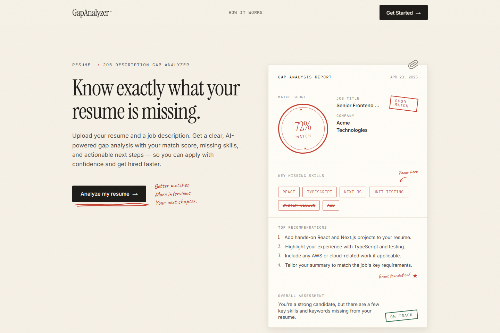
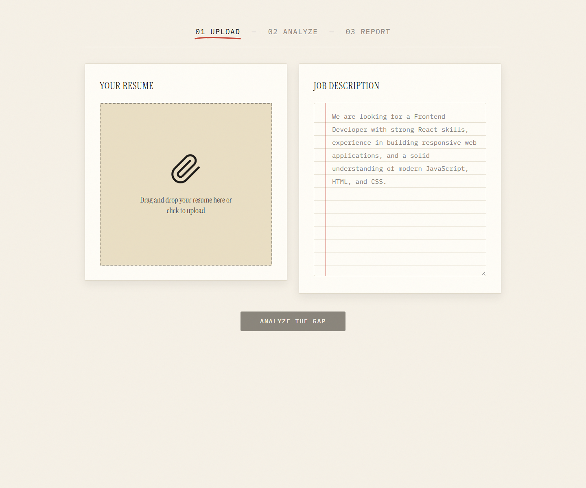
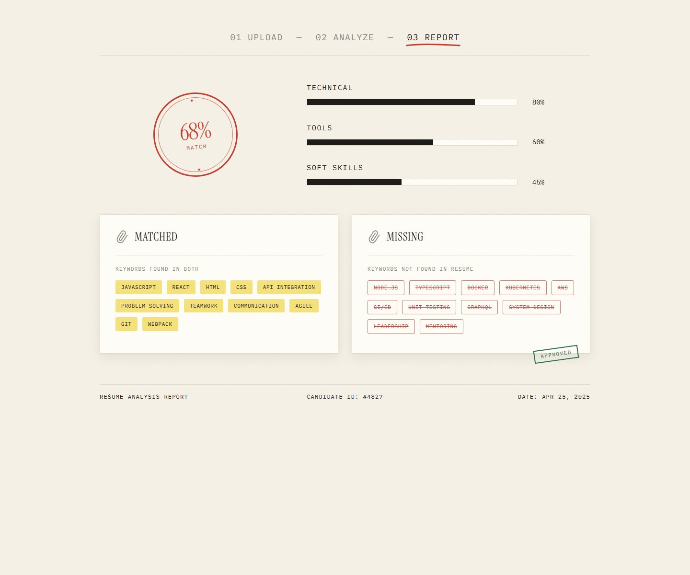
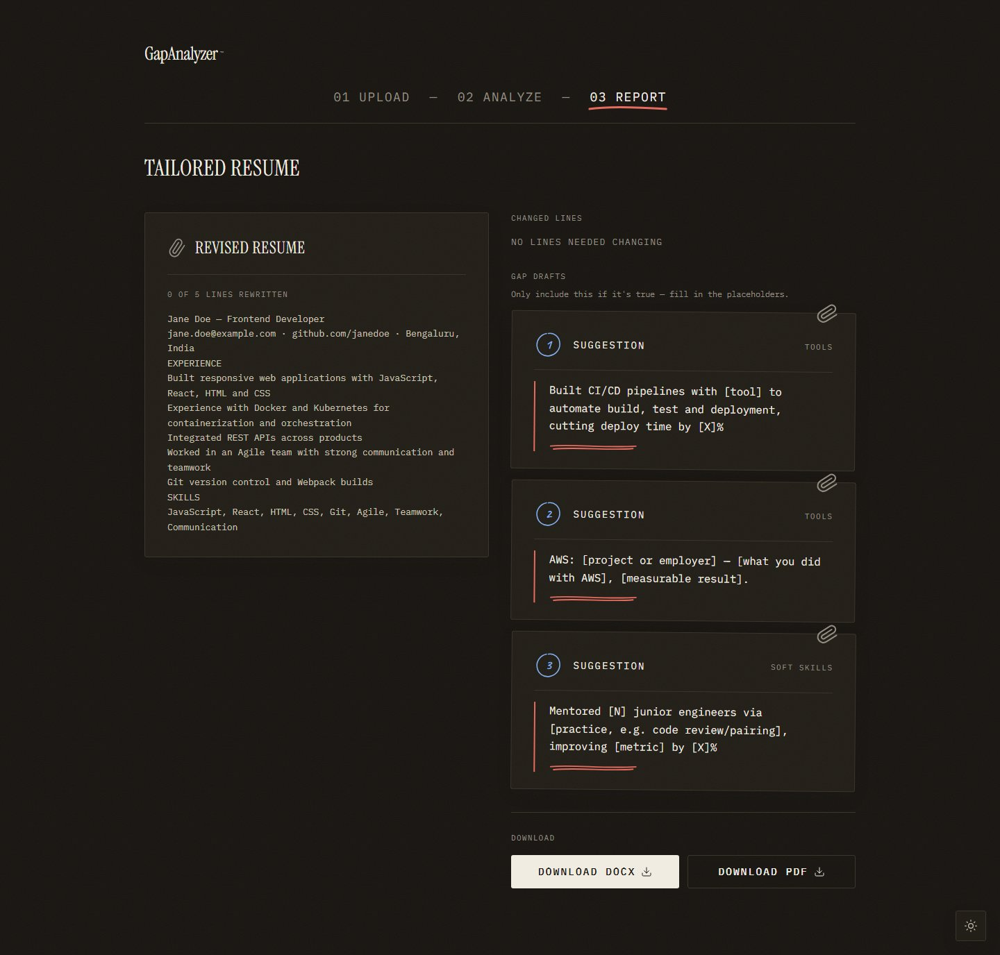
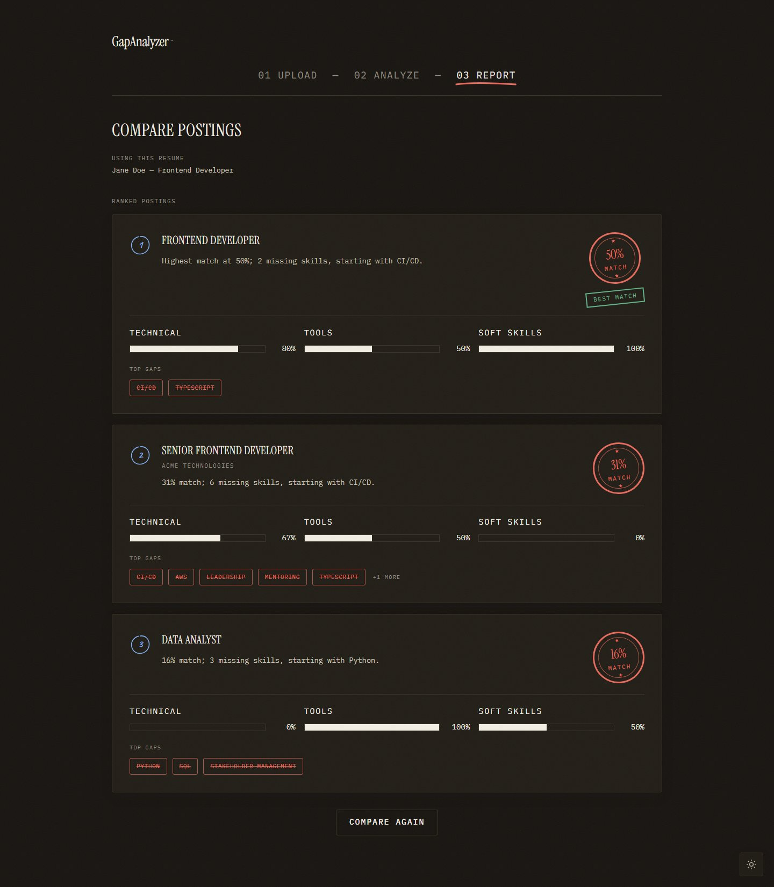

<p align="center">
  
</p>

<h1 align="center">GapAnalyzer</h1>

<p align="center">
  <strong>Know exactly what your resume is missing — then download a version tailored to the job you are applying for.</strong>
</p>

<p align="center">
  <a href="https://gap-analyzer-xi.vercel.app"></a>
  <a href="https://gapanalyzer-qvjn.onrender.com/docs"></a>
  
</p>

<p align="center">
  
  
  
  
  
  
</p>

GapAnalyzer reads a resume and a job description side by side, extracts the skills the posting actually asks for, marks the ones your resume never shows, explains *why* each gap matters, and rewrites the resume lines that can be improved using the posting's own vocabulary. Nothing is fabricated: every rewrite is checked against the original text, and gap-closing bullets ship as templates with placeholders for facts only you can supply.

It runs as a Next.js frontend on Vercel and a FastAPI backend on Render. No accounts, no database, no stored resumes — every request is self-contained, and the server keeps nothing.

**[Try it live](https://gap-analyzer-xi.vercel.app)** · **[API docs](https://gapanalyzer-qvjn.onrender.com/docs)** · **[Design system](DESIGN_SYSTEM.md)** · **[Build log](context.md)**

> The API runs on a small Render instance: the first analysis after an idle period takes about a minute while the embedding model loads, then it answers in seconds.

---

## Screenshots

| | |
| :---: | :---: |
|  |  |
| **Landing** — the hero sheet is a live report preview | **Upload** — drag a PDF/DOCX/TXT (≤ 5 MB) or paste text |
|  |  |
| **Match report** — score stamp, category bars, matched vs. missing keywords | **Tailored resume** — side-by-side review, gap drafts, DOCX/PDF export |
|  | |

Dark mode ships on every screen (the last two shots) — the palette is a token swap, so nothing branches on theme.

---

## Table of contents

- [What it does](#what-it-does)
- [How it works](#how-it-works)
- [Quickstart](#quickstart)
- [Configuration](#configuration)
- [API reference](#api-reference)
- [The rewrite guardrails](#the-rewrite-guardrails)
- [Repository layout](#repository-layout)
- [Testing](#testing)
- [Deployment](#deployment)
- [Known limitations](#known-limitations)
- [Documentation](#documentation)
- [License](#license)

---

## What it does

| Route | Screen | What happens |
| --- | --- | --- |
| `/` | Landing | Explains the product; the hero sheet is a real report preview |
| `/upload` | Upload | Drag a PDF/DOCX/TXT (≤ 5 MB) or paste resume text, paste the job posting, submit |
| `/results` | Match report | Match score stamp, per-category bars, matched keywords grouped by category (paraphrases marked `≈ MATCHED BY MEANING`), missing keywords, top recommendations, and a plain-language overall assessment |
| `/report` | Gap report | The five most important gaps, each with a reason and a mention count, plus copy-deck suggestion cards, a worked before/after example diff, and a downloadable PDF report |
| `/rewrite` | Tailored resume | A guarded LLM rewrite reviewed side by side with the original, one row per resume line; gap drafts; DOCX/PDF download rebuilt in your resume's own page format |
| `/compare` | Compare postings | One resume ranked against two or three postings, each with a score and a reason |

There is also `/demo/doodle-crew-footer`, an unlinked sandbox for a third-party footer component — not part of the product flow.

## How it works

```
 resume (PDF/DOCX/TXT) ──┐
                         ├─▶ extraction.py ──▶ clean text + page layout profile
 job posting (text) ─────┘                              │
                                                        ▼
                                       skills.py  ── 117-entry skill dictionary
                                                        │ (word-edge regex, aliases)
                                                        ▼
                            ┌───────────────────────────┴───────────────────────┐
                            │  keyword coverage (weighted by JD mention count)  │
                            │  semantic evidence (sentence embeddings, weeks 8–9)│
                            │  TF-IDF cosine similarity (scikit-learn)          │
                            └───────────────────────────┬───────────────────────┘
                                                        ▼
                               matching.py ──▶ analysis JSON consumed by the UI
                                                        │
                        ┌───────────────────────────────┼──────────────────────┐
                        ▼                               ▼                      ▼
                 rewrite.py (Gemini)          export.py (DOCX/PDF)     report.py (PDF)
```

**The score.** `match_score = round(100 × (0.6 × coverage + 0.4 × tfidf_cosine))`, where coverage is the share of JD-required skills found in the resume, weighted by how often the posting mentions each one. When the posting names no dictionary skills, the cosine stands alone. Category scores are `matched / required` per category, and read 100 when the posting asks for nothing in that category.

**Semantic matching.** A keyword miss is re-checked with sentence embeddings: each of the missing skill's alias phrases ("led a team", "continuous delivery", "unit tests") is compared against every resume sentence, and the best cosine above `0.50` promotes the skill to `matched_by: "semantic"`, counting at 0.75 weight — evidence in different words is good evidence, but not as certain as the word itself. The model is `all-mpnet-base-v2`; header and contact lines are excluded from evidence, because a name-and-role line weakly matches everything.

**The rewrite.** The model only ever sees numbered resume lines and returns text for those ids, so names, employers, dates and headings pass through verbatim. See [the guardrails](#the-rewrite-guardrails). If there is no key, no credit, a network failure or unusable JSON, the endpoint degrades to `mode: "fallback"` — the resume unchanged, plus the draft bullets — with a `reason` the UI can name. The endpoint does not 500 because the provider is down.

Parsing, scoring, exports and all copy are deterministic; the LLM is used for exactly one thing.

## Quickstart

**Requirements:** Python 3.12, Node 22, and ~2 GB of RAM for the backend (the embedder plus CPU PyTorch).

```bash
git clone https://github.com/prithvizenin/GapAnalyzer.git
cd GapAnalyzer
```

### 1. Backend

```bash
cd backend
python -m venv .venv && source .venv/bin/activate    # Windows: .venv\Scripts\activate
pip install --extra-index-url https://download.pytorch.org/whl/cpu torch
pip install -r requirements.txt
python main.py                                       # http://localhost:8000
```

`requirements.txt` deliberately omits torch so the container can install the CPU-only build (~200 MB) instead of the CUDA wheels (~2.5 GB) — locally you install it the same way, as above.

The first analysis downloads the embedding model (~420 MB) into the Hugging Face cache, so give it a minute; later requests reuse it. `GET /health` answers as soon as the server is up, and interactive API docs are served at <http://localhost:8000/docs>.

### 2. Frontend

```bash
cd frontend
npm install
npm run dev            # http://localhost:3000
```

With no environment variables the frontend talks to `http://localhost:8000`, which the backend's default CORS allowlist already permits — nothing to configure for local development.

### 3. Try it

[`samples/`](samples) holds a tested pair (a frontend-developer resume and a posted role). Paste `samples/frontend_resume.txt` and `samples/frontend_jd.txt` into `/upload`, or hit the API directly:

```bash
curl -s -X POST http://localhost:8000/api/analyze \
  -F "resume_text=<samples/frontend_resume.txt" \
  -F "job_description=<samples/frontend_jd.txt" | python -m json.tool
```

## Configuration

### Backend ([`backend/`](backend))

Everything is optional except a key if you want real LLM rewriting.

| Variable | Default | Purpose |
| --- | --- | --- |
| `GEMINI_API_KEY` | *(unset)* | Google AI Studio key for `/api/rewrite`. `GOOGLE_API_KEY` and `LLM_API_KEY` are accepted aliases. Can also live in `backend/.env` — shell variables always win over the file. |
| `LLM_BASE_URL` | `https://generativelanguage.googleapis.com/v1beta/openai` | OpenAI-compatible endpoint (Gemini is spoken to through this layer). |
| `LLM_MODEL` | `gemini-3.5-flash` | Primary model. Retired names and demand spikes fall through a short candidate ladder. |
| `LLM_TIMEOUT` | `120` | Seconds per provider call. |
| `ALLOWED_ORIGINS` | localhost:3000/3100, 127.0.0.1:3000/3100, `https://*.vercel.app` | CORS allowlist. Comma-separated; exact origins or `*` wildcards (`https://*.example.com`). Setting it replaces the defaults, so keep every origin you need. The resolved list is logged at startup (`CORS: exact=… wildcard=…`). |
| `EMBEDDING_MODEL` | `sentence-transformers/all-mpnet-base-v2` | Sentence-embedding model for semantic matching. |
| `SEMANTIC_THRESHOLD` | `0.50` | Cosine threshold for promoting a paraphrase to evidence. |

A viewer can also bring their own key: `/report` → **TAILOR MY RESUME →** opens a dialog that collects one in the browser and sends it as `api_key` on that request only. It lives in `sessionStorage` (dies with the tab) and is never stored, echoed or logged server-side.

### Frontend ([`frontend/`](frontend))

| Variable | Default | Purpose |
| --- | --- | --- |
| `NEXT_PUBLIC_API_URL` | `http://localhost:8000` | Backend origin. On Vercel this is inlined at **build** time, so changing it needs a redeploy. No trailing slash. |

Copy [`frontend/.env.example`](frontend/.env.example) to `frontend/.env.local` to set it locally.

## API reference

All routes are stateless: the client posts what it is looking at, the server computes and answers, and nothing is persisted. Errors use FastAPI's `{"detail": "..."}` envelope with the project's own wording. Route definitions live in [`backend/main.py`](backend/main.py); the response contract is [`backend/schemas.py`](backend/schemas.py).

### `GET /health`

```json
{ "status": "ok" }
```

### `POST /api/analyze`

`multipart/form-data` — a file (`resume`, PDF/DOCX/TXT, ≤ 5 MB) or pasted `resume_text`, plus a required `job_description`.

```bash
curl -s -X POST http://localhost:8000/api/analyze \
  -F "resume=@resume.pdf" \
  -F "job_description=<jd.txt"      # '<' sends the file's text as the field value
```

Returns `AnalysisResponse`:

```jsonc
{
  "resume_text": "…",                  // echoed back so /rewrite can reuse it
  "resume_layout": { … },              // measured page format, reused by the export
  "match_score": 43,
  "matched_skills": [
    { "skill": "React", "category": "technical", "matched_by": "keyword", "similarity": null },
    { "skill": "Leadership", "category": "soft", "matched_by": "semantic", "similarity": 0.586 }
  ],
  "missing_skills": [
    { "skill": "CI/CD", "category": "technical", "jd_mentions": 3, "why": "Commonly required in modern web development roles, especially for deployment and automation." }
  ],
  "categories": { "technical": 67, "tools": 50, "soft": 100 },
  "recommendations": [
    { "skill": "CI/CD", "category": "technical", "jd_mentions": 3, "message": "Add a bullet mentioning CI/CD — the posting emphasizes it 3 times." }
  ],
  "improvement_plan": ["…"],
  "overall_assessment": "…",
  "job_title": "Senior Frontend Developer",
  "company": "Acme Technologies",
  "diff_example": { "original": "…", "suggested": "…" }
}
```

Errors: `400` unsupported file type or no resume, `413` file too large, `422` no extractable text or no job description, `500` pipeline failure.

### `POST /api/rewrite`

JSON `{ resume_text, job_description, api_key? }` → the guarded tailored resume:

```jsonc
{
  "mode": "llm",                      // or "fallback"
  "reason": "",                       // names the cause when mode is "fallback"
  "model": "generativelanguage.googleapis.com:gemini-3.5-flash",
  "revised_resume": "…",
  "rewrites": [
    { "id": "L3", "original": "…", "revised": "…", "changed": true, "note": "…" }
  ],
  "additions": [
    { "skill": "CI/CD", "category": "technical", "draft": "…[…]", "note": "Only include this if it's true — fill in the placeholders." }
  ],
  "stats": { "candidates": 13, "changed": 4, "rejected": 0 }
}
```

`changed: false` means either the model left the line alone or the guard rejected its proposal — the original text is used either way. `reason` is one of `no_key`, `model_unavailable`, `rate_limited`, `overloaded`, `unreachable`, `provider_error`, `invalid_key`, `non_json`, `unexpected_body`, `no_candidate_lines`, so the UI can name the cause instead of blaming "the AI" for all of them.

### `POST /api/compare`

JSON `{ resume_text, job_descriptions: [ … ] }` — two or three postings, ranked. Each posting carries its own `match_score`, categories, matched/missing skills and a `reason` explaining the rank. `422` for fewer than two or more than three.

### `POST /api/rewrite/export`

JSON `{ resume_text, format: "docx" | "pdf", layout? }` → the document as a download. `layout` is the profile `/api/analyze` returned: the downloaded file is rebuilt in the uploaded resume's page geometry and type scale, falling back to a reference template when absent or partial.

### `POST /api/report/export`

JSON = the analysis payload (minus `resume_text`) plus `format` → the gap report as DOCX or PDF, rendered from the same numbers on screen so the file cannot drift from the page.

## The rewrite guardrails

The generator answers one question: *how do I say what I already did using the posting's words?* It may rephrase; it may not invent. Three layers keep that honest ([`backend/rewrite.py`](backend/rewrite.py)):

1. **Scope.** The model sees numbered resume content lines only (at most 24, each ≤ 400 chars). Names, employers, dates, headings and section labels are never sent as editable and are copied through verbatim.
2. **Deterministic guards.** A proposed rewrite is rejected if it introduces a number the original line did not contain, names a skill the resume does not already evidence (above all a *missing* skill), or grows past 180% of the line's length. A rejected line keeps its original text — the worst case is "no improvement", never a false claim.
3. **Additions are drafts, not content.** Each gap gets one bullet template that must contain `[...]` placeholders for facts only the candidate can supply. Drafts are never spliced into `revised_resume`.

## Repository layout

```
backend/                  FastAPI service (flat imports; Docker context = backend/)
  main.py                    routes, CORS allowlist, startup logging
  schemas.py                 the response contract, as Pydantic models
  extraction.py              PDF/DOCX/TXT → clean text (+ glyph repair)
  layout.py                  page geometry, role type scale, line classification (+ clamps client-supplied profiles)
  skills.py                  117-entry dictionary + word-edge regex matcher
  matching.py                scoring, recommendations, comparison, improvement plan
  embeddings.py              sentence-embedding semantic evidence layer
  rewrite.py                 guarded Gemini rewrite, fallback ladder, key resolution
  export.py                  DOCX/PDF rendering in the resume's own layout
  report.py                  the gap report as printable text
  smoke_test.py              73 contract checks against a running API
  security_probe.py          hostile-input probe (export layout, upload size, report payloads)
  Dockerfile                 python:3.12-slim + CPU torch, one uvicorn worker

frontend/                 Next.js 16 (App Router, TypeScript, Tailwind v4)
  src/app/                   /, /upload, /results, /report, /rewrite, /compare
  src/components/ui/         design-system primitives (Sheet, StampScore, SkillChip, …)
  src/components/upload/     AnalyzingPanel (screen-03 checklist)
  src/components/rewrite/    TailoringPanel (gliding-page loader while the rewrite runs)
  src/lib/motion.ts          GSAP + ScrollTrigger, gated on prefers-reduced-motion
  src/lib/api.ts             API base URL + the per-tab key storage

docs/screens/             the screenshots above
samples/                  frontend_resume.txt + frontend_jd.txt — a tested pair
comps/                    screen comps the UI is drift-checked against
render.yaml               Render blueprint for the API
```

The frontend's visual language — a "marked-up dossier" of paper, hairlines, red pen and highlighter — plus its motion rules live in [`DESIGN_SYSTEM.md`](DESIGN_SYSTEM.md); [`context.md`](context.md) is the decision log and source of truth.

## Testing

There is no pytest suite — the backend's contract test is a script that drives a **running** API, so model loading, uploads, every error path and the export binaries are exercised through HTTP:

```bash
cd backend
python main.py                    # terminal 1
python smoke_test.py              # terminal 2 → prints 73/73 passed
```

It covers TXT upload, pasted text, a real generated PDF and a DOCX, the 400/413/422 error contract, semantic promotion (a paraphrase passes, a distractor stays missing), categorized suggestions, the improvement plan, rewrite invariants and fallbacks, comparison, and the DOCX/PDF magic bytes and headers. Point it elsewhere with `GAPANALYZER_API=http://host:port`.

`security_probe.py` drives the same running API with hostile input — crafted export `layout` profiles (string widths, a 1e9-pt page, unknown fonts, 9-float colours, NaN literals), a 6 MB upload, and malformed report payloads. Every case must answer 200/413/422; a 500 is a regression. Run it after touching `layout.py` or either export route:

```bash
python security_probe.py          # → FAILURES: 0
```

> **Warm the API first on a cold machine.** The smoke test uses a 30-second client timeout, and the very first analysis loads the ~420 MB embedding model — so on a fresh instance, send one analysis (the `curl` above) and wait for it to finish before running the suite, or the first check fails with `httpx.ReadTimeout` rather than a real defect.

The frontend's check is a production build, which includes typechecking and static generation:

```bash
cd frontend && npm run build
```

## Deployment

**Backend → Render.** [`render.yaml`](render.yaml) is a blueprint (`Dashboard → New → Blueprint`): Docker runtime, `standard` plan (2 GB — the 512 MB tiers OOM on torch + the embedder), health check on `/health`, `HF_HOME=/data/hf` with a 5 GB disk so the model survives restarts. `ALLOWED_ORIGINS` and `GEMINI_API_KEY` are marked `sync: false` and are optional:

- `ALLOWED_ORIGINS` only matters for a custom domain — the code default already allows `https://*.vercel.app` and localhost.
- `GEMINI_API_KEY` only matters if you want rewriting to work without each viewer bringing a key.

**Frontend → Vercel.** Point the project at `frontend/`, set `NEXT_PUBLIC_API_URL` to the Render origin (build-time, no trailing slash), deploy. CORS is an exact-origin match unless you use a wildcard, so a renamed Vercel project means updating `ALLOWED_ORIGINS`.

**Order matters:** deploy the API first, then the frontend with that URL. After changing backend code, redeploy the service — a restart alone reuses the old image.

Nothing here is a security boundary by design: the API is stateless, credential-free, stores no resumes and accepts no cookies. CORS exists so the browser will talk to it, not to protect data — there is none to protect.

## Known limitations

- **Scanned/image PDFs are not supported** — there is no OCR; extraction returns `422 No extractable text found`. DOCX and TXT work, and text can always be pasted.
- **The first analysis is slow.** The embedding model (~420 MB) downloads on first use, so on a fresh Render instance the first `/api/analyze` can take minutes. Later requests are fast.
- **Single worker.** One uvicorn worker keeps the embedder's memory to one copy; concurrent analyses queue behind each other.
- **`/api/rewrite` can take up to two minutes** against the live model (`LLM_TIMEOUT`). The progress UI is illustrative — the endpoint streams nothing, so the bar estimates and deliberately stops below 100%.
- **Semantic matching is tuned on a small calibration set** (threshold 0.50, favouring precision). Real-resume testing is ongoing; a missed paraphrase costs less than a false "you already have this".
- **No sample corpus yet.** [`samples/`](samples) holds one verified pair; the wider 10–15 resume/posting set for scoring evaluation is still being collected.
- **No persistence or accounts** by design, so there is no history of past analyses.

## Documentation

| File | Contents |
| --- | --- |
| [`context.md`](context.md) | Decision log and source of truth: architecture, contract, every task's rationale, gotchas |
| [`DESIGN_SYSTEM.md`](DESIGN_SYSTEM.md) | Colour/type/spacing tokens, motion rules, component inventory, copy deck |
| [`tech_stack.txt`](tech_stack.txt) | Plain-text stack inventory |
| [`Tech_Stack_and_Architecture.pdf`](Tech_Stack_and_Architecture.pdf) | Architecture reference for the report |
| [`MiniProject_MidSem_Report.pdf`](MiniProject_MidSem_Report.pdf) | Mid-semester report: problem, approach, limitations, next steps |
| [`samples/`](samples) | A resume/posting pair for hands-on testing |

## License

No license has been added to this repository yet. The code is published for review and portfolio purposes — please ask before reusing it.
